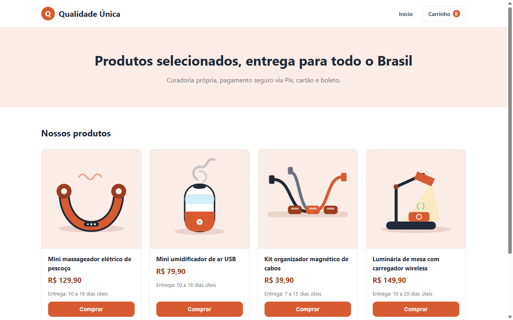
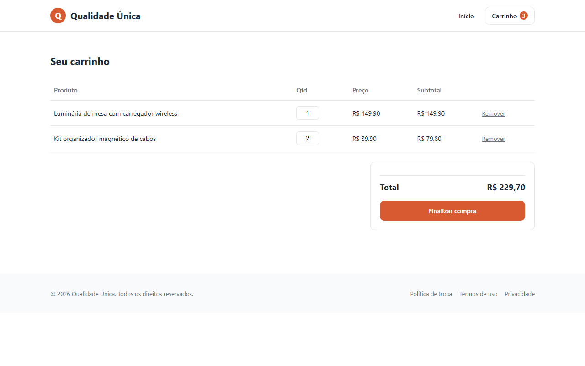
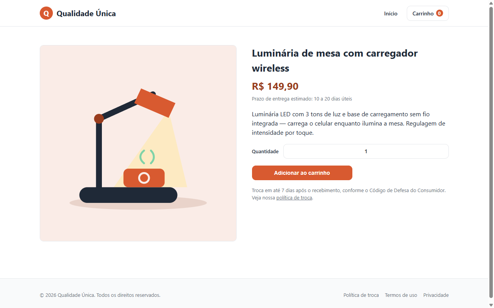

# Online Store with Mercado Pago Checkout

[](https://github.com/fontanella01/online-store-mercadopago/actions/workflows/ci.yml)

A lightweight e-commerce storefront built with **plain HTML, CSS and JavaScript** (no framework, no build step) and **serverless functions on Cloudflare Pages** that create payments through **Mercado Pago Checkout Pro** (Pix, card and boleto).

Built in one day as a complete, deployable store: catalog, product pages, cart, checkout, payment return page and the legal pages required in Brazil (returns policy, terms and privacy/LGPD).

| Catalog | Cart |
|---|---|
|  |  |



## Features

- Product catalog and product detail pages
- Cart stored in `localStorage`, with quantity editing and totals
- Checkout form that creates a Mercado Pago payment preference and redirects the customer
- Order number generated on the server and sent as `external_reference`, shown on the confirmation page
- Payment confirmation page (approved / pending / failed)
- Webhook that verifies Mercado Pago's signature, fetches the payment from the API and e-mails the store when a sale is approved (optional, via Resend)
- Unit tests for price validation and webhook signatures, running on GitHub Actions
- Returns policy, terms of use and privacy policy pages
- Zero dependencies: deploy the folder as-is

## Architecture

```
Browser (static HTML/JS)          Cloudflare Pages Functions          Mercado Pago
---------------------------       ----------------------------        -------------
cart: [{ id, quantity }]  ──POST /criar-pagamento──▶  validates items,
                                   reads prices from    ──create preference──▶
                                   functions/_catalog.js
                          ◀── redirect URL (init_point) ──
                                   /webhook-mercadopago ◀── payment notifications
                                   1. verify x-signature (HMAC-SHA256)
                                   2. GET /v1/payments/{id}  ──────────▶
                                   3. log + e-mail the store if approved
```

- `functions/_catalog.js` is the **server-side source of truth** for product names and prices. Files in `functions/` are not served as static assets, so internal data (cost, supplier) stays private.
- `js/products.js` holds only what the customer sees.

## Security

An early version trusted the `unit_price` sent by the browser, which meant anyone could edit the request and pay any amount for a product. It was fixed by:

- sending only **product id and quantity** from the browser
- looking up name and price **on the server** (`functions/_catalog.js`)
- validating product ids and quantities (integers from 1 to 20)
- moving cost and supplier data out of the public catalog
- logging Mercado Pago errors on the server instead of returning them to the client

The Mercado Pago access token is read from an environment variable and never shipped to the browser.

The webhook does not trust the notification body either:

- it checks the `x-signature` header (HMAC-SHA256 over the payment id, request id and timestamp) with the secret from the Mercado Pago dashboard, using a constant-time comparison
- it rejects notifications older than 5 minutes, so a captured request can't be replayed later
- it reads the payment status from the Mercado Pago API, never from the request
- if the API call fails it answers `500`, so Mercado Pago retries the notification

## Project structure

```
index.html, produto.html, carrinho.html, checkout.html, confirmacao.html
politica-de-troca.html, termos.html, privacidade.html
css/style.css                     -> all styles (brand color in --brand)
js/products.js                    -> public product list (display only)
js/cart.js                        -> cart logic (localStorage)
js/render.js                      -> page rendering and checkout request
functions/_catalog.js             -> official prices and internal product data
functions/criar-pagamento.js      -> creates the Mercado Pago payment
functions/webhook-mercadopago.js  -> verifies and processes payment notifications
img/produtos/                     -> product illustrations (SVG)
tests/                            -> unit tests (node:test, no dependencies)
```

## Running and deploying

1. **Products:** edit `functions/_catalog.js` (official price) and `js/products.js` (what is displayed). Keep prices in sync.
2. **Mercado Pago:** create an account and copy the **test** access token first.
3. **Deploy on Cloudflare Pages:** connect this repository, framework preset `None`, no build command, output directory `/`.
4. **Environment variables:**
   - `MP_ACCESS_TOKEN`: Mercado Pago access token (start with the test one)
   - `SITE_URL`: your site URL, e.g. `https://my-store.pages.dev`
   - `MP_WEBHOOK_SECRET`: the secret signature shown in Mercado Pago's webhook settings
   - `RESEND_API_KEY` and `STORE_EMAIL` (optional): send an e-mail to the store on each approved sale
5. Test a full purchase with the test token, then switch to the production token.

To preview the static pages locally: `npx http-server .` (the checkout needs the Cloudflare functions to run).

To run the tests (Node 22+, no install needed): `npm test`.

## Next steps

- Store orders in a database (Cloudflare D1) and show order status to the customer
- Send a confirmation e-mail to the customer, not only to the store
- Stock control

---

Made by [Vinícius Fontanella Kleis](https://www.linkedin.com/in/vinicius-fontanella/).
